# Executive summary

**FOREST_SAR_HN** is an exploratory, public web observatory that lets anyone look at where the real radar signal of NASA-ISRO's **NISAR** satellite changed between two dates over a provisional study window in Honduras (bounding box -87.35, 14.00, -87.05, 14.35; it is *not* a municipal boundary). It needs no account and no credentials: the site only reads static scientific files that a Python engine produced beforehand from public NASA data.

**What it does.** The engine searches NASA's public catalog (CMR) for NISAR L2 GCOV scenes, keeps pairs from the same orbit (track 98, frame 81, descending, L-band, HVHV polarization), averages the signal into 1-hectare cells and computes the change in decibels (dB). Cells whose signal dropped by 3 dB or more are marked as **candidates** and grouped into **zones**. The web app shows them on interactive maps, with indicators, an evolution view, downloadable CSV files, a methodology page and a technical data page.

**Real results (catalog consulted on 2026-11-15).** 52 scenes were found (47 provisional, 5 validated), 1,326 pairs were evaluated and 162 were compatible. Four comparisons were processed, all ending on 2026-10-19: 12 days (23 ha, 20 zones), 36 days (17 ha, 11 zones), 60 days (28 ha, 25 zones) and 84 days (165 ha, 98 zones). The valid area is 117,537 ha with 93.8% coverage. These figures are not added up because the periods share the same end date.

**Forest & Conservation.** A separate educational page (`#/conservation`) explains Honduras' forests (ICF 2018 figures, labelled as historical), the protected areas around the Central District (with source discrepancies shown side by side), threats, benefits, radar technology and a demo-only participation flow that collects no personal data. It does not process data; its only system figures are read from the published snapshots.

**What it is not.** A candidate is a *decrease in radar backscatter*, not confirmed deforestation, not an official alert and not a prediction. The vegetation-cover traffic light is shown as "Not evaluated" because comparable vegetation measurements do not exist. The community section is a local demonstration.

**Technology.** React 19, TypeScript, Vite 8 and Leaflet on the front end; Python 3.12 with earthaccess, harmony-py, numpy, rasterio, h5py and shapely in the engine. Development was orchestrated with Claude Code (Opus, Sonnet and Haiku roles) with OpenAI Codex as a hand-over agent and human review of every scientific claim. No generative AI runs inside the product and no image was AI-generated.

**Tests.** pytest: 45 passed. Playwright: 166 passed, 8 skipped, 0 failed. Type check and production build: OK.

# 1. Presentación

Este manual explica, en lenguaje sencillo, qué es **FOREST_SAR_HN**, cómo usarlo, qué significan sus resultados y, sobre todo, qué *no* significan. Está pensado para cuatro tipos de lector: personas de la comunidad, docentes y estudiantes, personal técnico y personas que evalúan el proyecto.

:::tarjetas
- 52 | escenas NISAR encontradas | Catálogo CMR, 2026-11-15 | sat
- 4 | comparaciones procesadas | 12, 36, 60 y 84 días | layers
- 165 ha | candidatas en 84 días | no es deforestación | leaf
- 0 | cuentas o claves necesarias | sitio estático | check
:::

## 1.1 El proyecto en pocas palabras

FOREST_SAR_HN es un observatorio web. Toma datos reales del satélite NISAR (NASA e ISRO), los procesa con un motor científico propio y publica el resultado como archivos estáticos. La aplicación web los muestra en mapas, tablas y gráficos para que cualquier persona pueda ver **dónde bajó la señal del radar** entre dos fechas y qué tan grande fue el cambio.

El proyecto es un **prototipo exploratorio** creado para el reto *Dancing with the SARs* de NASA Space Apps 2026. No es un servicio oficial de alertas y no sustituye la inspección en campo.

## 1.2 Qué es un radar de apertura sintética (SAR)

Un radar SAR envía pulsos de microondas hacia la superficie y mide la energía que regresa, llamada **retrodispersión**. Como el radar lleva su propia "luz", puede observar de día y de noche, y la banda L de NISAR atraviesa nubes. La cantidad de energía devuelta depende de la estructura de la superficie (hojas, ramas, suelo), de su humedad y de la geometría de observación. Por eso, un cambio en la señal es una **pista** que hay que interpretar, no una respuesta.

:::nota Idea clave
El radar no "ve" árboles caídos ni causas. Mide energía devuelta. FOREST_SAR_HN solo señala dónde esa energía bajó más de un umbral entre dos fechas; la interpretación se hace con otras fuentes y con conocimiento local.
:::

## 1.3 Cómo está organizado este manual

Las secciones 2 y 3 responden las cinco preguntas del formulario del reto y resumen los resultados. Las secciones 4 a 11 son la guía de uso, pantalla por pantalla; la 10 presenta la página educativa *Bosques y Conservación*. Las secciones 12 a 14 explican el método, la arquitectura y las limitaciones. El final incluye preguntas frecuentes, mejoras futuras, referencias y la declaración de uso de inteligencia artificial.

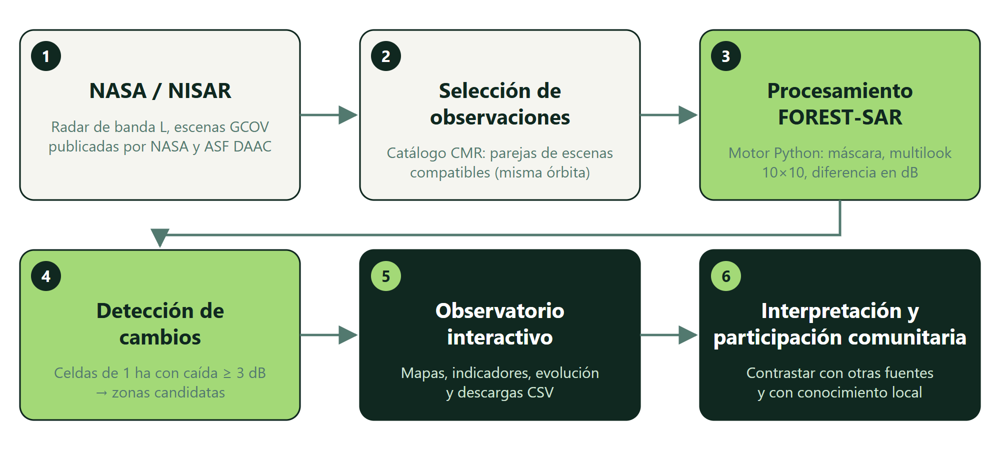

# 2. Las cinco preguntas del formulario

Las respuestas de esta sección se repiten, listas para copiar, en el archivo `Respuestas_5_preguntas_FOREST_SAR_HN.md`.

## ¿Qué hace o cómo funciona?

FOREST_SAR_HN compara pares de escenas reales del satélite NISAR y muestra dónde disminuyó la señal del radar entre dos fechas. Funciona en dos partes separadas.

**Parte 1, motor científico (en el computador del equipo).** Un programa en Python consulta el catálogo público de NASA (CMR), elige parejas de escenas de la misma órbita, descarga solo el recorte necesario mediante Harmony y calcula el cambio. Promedia el radar en celdas de 100 m (1 hectárea), calcula la diferencia en decibelios y marca como *candidatas* las celdas que bajaron 3 dB o más. Las celdas cercanas se agrupan en *zonas*. El resultado se guarda como archivos versionados.

**Parte 2, observatorio web (en el navegador).** Una aplicación React lee esos archivos y los muestra: un mapa con zonas y burbujas, selección de período (12 días, 1, 2 y 3 meses), indicadores, una vista de evolución, descargas CSV, una biblioteca de recursos, la metodología completa y una página de datos técnicos. No exige cuenta ni claves, y todo está en español e inglés.

**Qué mide y qué no.** Mide un cambio de retrodispersión. No identifica deforestación, causas ni responsables.

## ¿Qué beneficios tiene?

**Beneficios demostrados (ya existen y se pueden comprobar).**

- Datos reales de NISAR procesados de punta a punta: 52 escenas catalogadas, 1 326 parejas evaluadas y 4 comparaciones publicadas con sus identificadores, fechas y métricas.
- Un observatorio público y sin cuenta que muestra el resultado en mapas, indicadores y gráficos, con descarga de CSV para uso técnico.
- Transparencia: cada cifra indica su fuente, fecha, umbral y limitaciones; las páginas de metodología y de datos técnicos exponen el procesamiento.
- Educación ambiental: la página *Bosques y Conservación* explica los bosques de Honduras, las áreas protegidas del Distrito Central y el radar satelital con fuentes citadas y cifras históricas marcadas como tales.
- Reproducibilidad: pruebas automáticas (pytest 45 aprobadas; Playwright 166 aprobadas) y una versión de publicación verificada.
- Costo de operación bajo: es un sitio estático que no necesita servidor, base de datos ni credenciales.

**Beneficios potenciales (aún no demostrados).**

- Orientar a comunidades y a docentes sobre dónde conviene mirar con otras fuentes o en campo.
- Servir como base educativa para entender el radar SAR.
- Con más observaciones y validación en terreno, servir de apoyo a una futura vigilancia del cambio de cobertura.

Estos beneficios potenciales dependen de validación que todavía no se ha hecho.

## ¿Cuál es el impacto previsto del proyecto?

**Ambiental.** Hacer más visible dónde cambia la señal del radar sobre el paisaje, como invitación a revisar con imágenes ópticas, mapas locales o visitas de campo. No cuantifica pérdida de bosque.

**Social.** Acercar datos satelitales abiertos a personas sin formación técnica, con textos sencillos, español e inglés, sin cuenta y con una sección comunitaria de demostración donde imaginar conversaciones sobre el territorio.

**Tecnológico.** Mostrar un flujo abierto y reproducible: datos públicos de NASA, procesamiento en Python y publicación estática. Cada paso queda documentado y probado, y el patrón se puede repetir en otras ventanas de estudio.

**A largo plazo.** Si se agregan más observaciones NISAR, la vista de evolución podrá mostrar series más largas, y con validación externa podrá apoyar procesos locales de observación.

**Lo que el proyecto no promete.** No tiene convenios con instituciones, no emite alertas oficiales, no predice cambios y no realiza monitoreo automático: hoy los datos se procesan y se publican manualmente.

## ¿Qué herramientas, lenguajes de codificación, hardware o software utilizó para desarrollar su proyecto?

Todo lo listado se verificó en los archivos del repositorio.

| Categoría | Herramienta | Para qué se usó |
|---|---|---|
| Lenguajes | TypeScript, JavaScript, Python 3.12, CSS, HTML | Aplicación web, scripts, motor científico y estilos |
| Interfaz web | React 19, react-dom, Vite 8, @vitejs/plugin-react | Construcción de la aplicación y compilación |
| Mapas e iconos | Leaflet 1.9.4, lucide-react | Mapas interactivos e iconografía |
| Motor científico | earthaccess, harmony-py, numpy, rasterio, h5py, shapely, requests | Descarga, lectura de GeoTIFF/HDF5, cálculo de cambios y geometrías |
| Pruebas | pytest, Playwright (Chrome del sistema), TypeScript (typecheck) | Pruebas del motor, de la interfaz y comprobación de tipos |
| Construcción | Node.js, npm, esbuild | Instalación de dependencias, build y verificación de publicación |
| Datos y servicios | NASA Earthdata, CMR, Harmony, ASF DAAC, NISAR L2 GCOV, GIBS/Worldview | Catálogo, descarga de recortes y capas de contexto |
| Mapas base | OpenStreetMap/Overpass (ODbL), Esri World Imagery, OpenTopoMap | Mapas de referencia y búsqueda de localidades |
| Fotografías | Wikimedia Commons (CC BY-SA, CC BY, CC0, dominio público), convertidas a WebP | Fotos reales de Honduras en Bosques y Conservación, con autor y licencia visibles |
| Entorno | Git (rama local), Visual Studio Code con la extensión Claude Code | Control de versiones y edición |
| Inteligencia artificial | Claude Code (Opus 5.5, Sonnet 5.5, Haiku 5.5) y OpenAI Codex | Apoyo al desarrollo y la documentación, con revisión humana |
| Hardware | Computadoras personales del equipo y conexión a Internet | Desarrollo y procesamiento local |

**Sobre el hardware y NISAR.** El equipo trabajó con computadoras personales y conexión a Internet. El satélite NISAR es una misión de NASA e ISRO que **no construimos nosotros**: usamos sus datos públicos.

**Declaración de IA.** Claude Code apoyó la escritura de código, pruebas y documentación; OpenAI Codex actuó como agente de relevo. La aplicación y el motor **no usan IA en tiempo de ejecución**, ninguna imagen fue generada por IA y el equipo revisó las afirmaciones científicas.

## ¿Cómo es creativo tu proyecto?

La creatividad de FOREST_SAR_HN está en **cómo integra y presenta** información existente, no en haber inventado el radar ni la misión NISAR, que pertenecen a NASA e ISRO.

- **Traducción a lenguaje cotidiano.** Convierte decibelios y retrodispersión en preguntas que cualquiera entiende: ¿dónde bajó la señal?, ¿cuánto?, ¿qué no sabemos?
- **Honestidad visible.** El semáforo marca "No evaluado" cuando faltan datos, los avisos acompañan cada cifra y el mapa explica que el contorno es una ayuda de lectura. La incertidumbre es parte del diseño.
- **Una sola experiencia en tres pasos.** Elegir período, explorar el mapa, entender los resultados; con burbujas que agrupan zonas, búsqueda por localidad y capas de contexto de NASA.
- **Integración de fuentes abiertas.** Une NISAR, GIBS, OpenStreetMap y mapas base en una interfaz común, bilingüe y sin cuenta.
- **Ciencia abierta y reproducible.** Todo el procesamiento queda versionado y probado, de modo que otras personas puedan repetirlo.
- **Participación.** Propone un espacio comunitario para contrastar la señal con el conocimiento de quienes viven en el territorio.

# 3. Resultados y logros

:::tarjetas
- 52 | escenas encontradas | 47 provisionales, 5 validadas | sat
- 1 326 | parejas evaluadas | 162 compatibles | layers
- 4 | comparaciones | fecha final 2026-10-19 | chart
- 117 537 ha | área válida | cobertura 93,8 % | map
:::

El catálogo público CMR se consultó el 2026-11-15 sobre la ventana de estudio provisional (-87.35, 14.00, -87.05, 14.35) para el período de búsqueda del 2026-06-01 al 2026-10-31. Se usó la órbita track 98, frame 81, descendente, mirada izquierda, polarización HVHV, banda L. Entre las 1 326 parejas posibles, 162 resultaron compatibles y 1 164 no lo fueron (por ejemplo, órbitas o geometrías distintas).

## 3.1 Comparaciones procesadas

| Período | Fecha inicial | Fecha final | Hectáreas candidatas | Zonas |
|---|---|---|---|---|
| 12 días | 2026-10-07 | 2026-10-19 | 23 ha | 20 |
| 36 días | 2026-09-13 | 2026-10-19 | 17 ha | 11 |
| 60 días | 2026-08-20 | 2026-10-19 | 28 ha | 25 |
| 84 días | 2026-07-27 | 2026-10-19 | 165 ha | 98 |

En total se usaron 5 fechas de observación. El área válida es de 117 537 ha en todas las comparaciones, la cobertura es de 93,8 % y la proporción candidata en 84 días es de 0,14 %.

:::aviso No sume los períodos
Las cuatro comparaciones comparten la fecha final (2026-10-19), así que se solapan y una misma zona puede aparecer en varias. Sumar 23 + 17 + 28 + 165 no tiene significado. Además, 165 ha es una *disminución candidata de retrodispersión*, **no deforestación**, y el período de 84 días cruza la estación lluviosa, que también cambia la señal.
:::

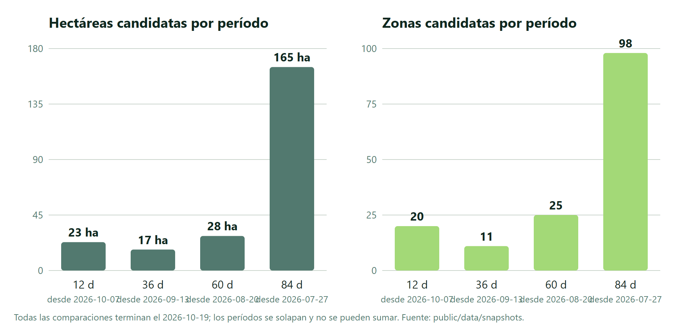

## 3.2 Validación técnica

| Prueba | Resultado |
|---|---|
| pytest (motor científico) | 45 aprobadas |
| Playwright (interfaz) | 166 aprobadas, 8 omitidas, 0 fallidas |
| Comprobación de tipos y compilación | Correctas |
| Verificación de la versión de publicación | `npm run build:publish` comprueba que `dist` no incluya claves, rutas locales ni archivos privados |

# 4. Acceso

El sitio es **público y no requiere cuenta, correo ni claves**. Se abre en cualquier navegador moderno, en computador, tableta o teléfono.

- **Enlace público:** [davs463.github.io/FOREST-SAR](https://davs463.github.io/FOREST-SAR/) (publicado con GitHub Pages). Código fuente: [github.com/Davs463/FOREST-SAR](https://github.com/Davs463/FOREST-SAR).
- **Navegación:** la barra superior tiene Observatorio, Evolución, Observaciones, Bosques y Conservación, Comunidad, Biblioteca y Metodología; el logotipo lleva al Inicio. En pantallas medianas y pequeñas el menú se abre con el botón ☰.
- **Idioma:** el botón ES/EN cambia toda la interfaz; el inglés es completo.
- **Rutas:** las direcciones usan `#/`, por ejemplo `#/observatory`, `#/analytics`, `#/observations`, `#/conservation` y `#/data`, así que se pueden guardar como favoritos.

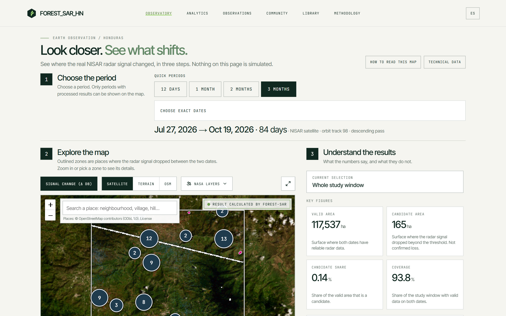

## 4.1 Uso en el teléfono

La interfaz se adapta a pantallas pequeñas: el mapa ocupa el ancho disponible y los paneles pasan debajo.

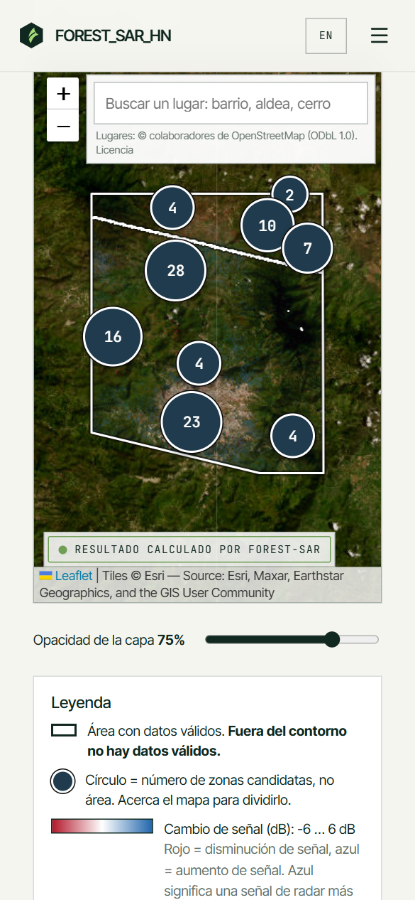

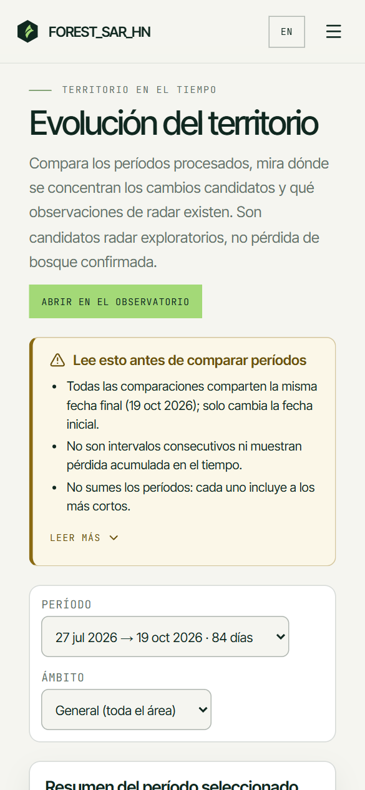

:::nota Para evaluadores
No hay que iniciar sesión ni instalar nada. Si el navegador está en inglés, use el botón de idioma para alternar. Todos los datos mostrados son reales; la única parte simulada es la sección Comunidad y está marcada como demostración.
:::

# 5. Inicio

La página de **Inicio** presenta el proyecto con una escena ilustrada original (arte propio en SVG y CSS) y explica en tres pasos cómo la señal de radar se convierte en una observación: enviar una señal, leer el retorno y comparar en el tiempo.

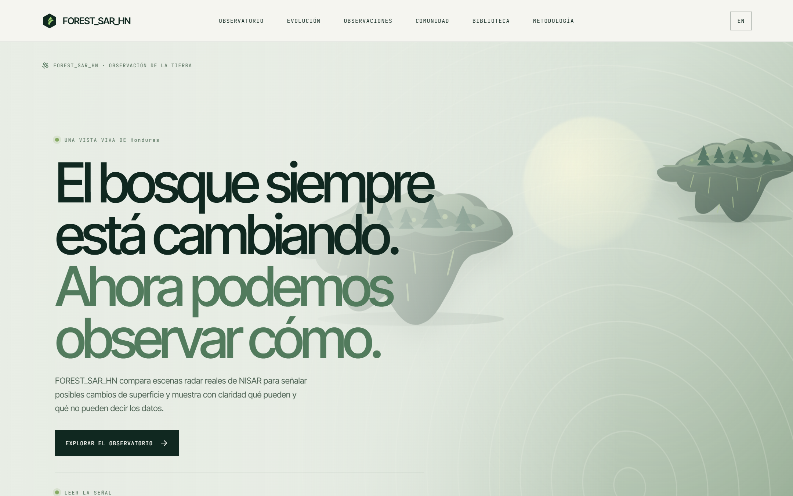

Desde aquí se puede entrar al Observatorio, ver cómo funciona o unirse a la conversación en Comunidad. Una franja visible recuerda que el sitio es un **prototipo exploratorio y no un servicio oficial de alertas**.

# 6. Observatorio

El Observatorio es la pantalla principal. Está organizado en **tres pasos**: elegir el período, explorar el mapa y entender los resultados.

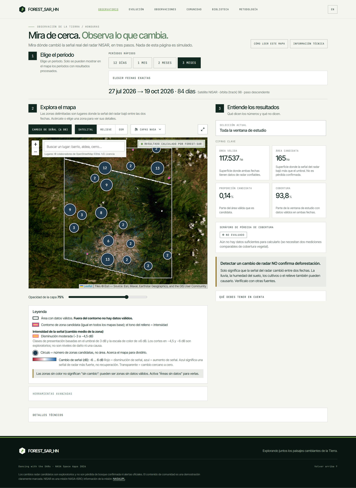

## 6.1 Elegir el período

El primer paso ofrece cuatro períodos: **12 días, 1 mes, 2 meses y 3 meses**. Corresponden a las comparaciones de 12, 36, 60 y 84 días. Las fechas exactas están plegadas y se pueden desplegar. Solo se pueden seleccionar períodos con resultados procesados.

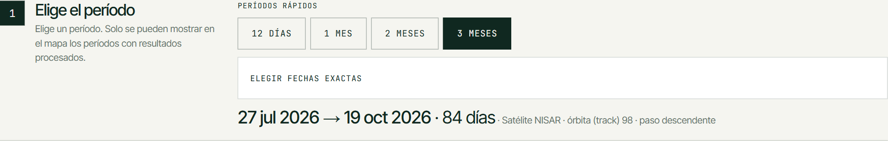

Al cambiar de período, el mapa y los indicadores se actualizan. Todos terminan el 2026-10-19, por lo que son comparaciones **solapadas**: no son cuatro cambios distintos.

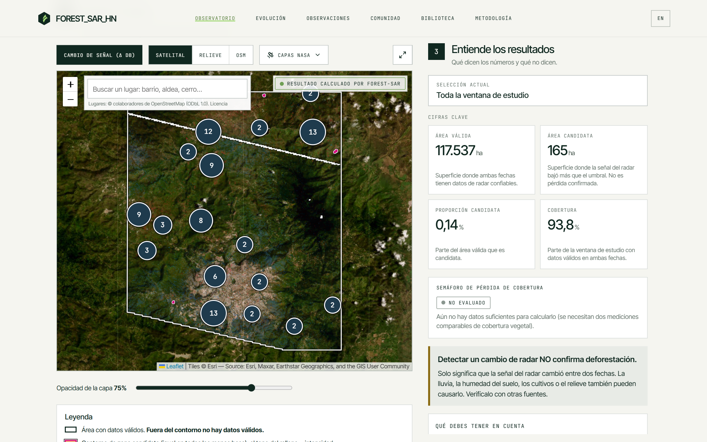

## 6.2 Leer el mapa

En el mapa se distinguen estos elementos:

- **Zonas candidatas:** contorno magenta con relleno según la intensidad del cambio.
- **Zona seleccionada:** halo cian alrededor de la zona elegida.
- **Contorno de área válida:** línea blanca con borde oscuro que marca dónde hay datos válidos.
- **Capa de cambio (Δ dB):** muestra el cambio de señal como imagen.
- **Burbujas numeradas:** indican el **número de zonas**, no el área. Al hacer clic, el mapa se acerca.
- **Polígonos:** a partir del nivel de zoom 14 se dibuja cada zona con su forma.
- **Opacidad:** un control bajo el mapa permite ver a través de la capa de radar.
- **Capas avanzadas:** celdas de 100 m y cuadrícula de sectores. El modo Antes/Después solo aparece en las *Herramientas avanzadas* (panel plegable); no es la función principal.

Sobre el mapa hay una **barra de herramientas** con la capa *Cambio de señal (Δ dB)*, el selector de **mapa base** (Satelital · Relieve · OSM), el menú **Capas NASA** y el botón **Ver mapa en grande** (icono de flechas). Este último abre el mismo mapa a casi toda la pantalla, con zoom, búsqueda, selector de zonas y una leyenda plegable; se cierra con **Cerrar** o con la tecla *Esc*.

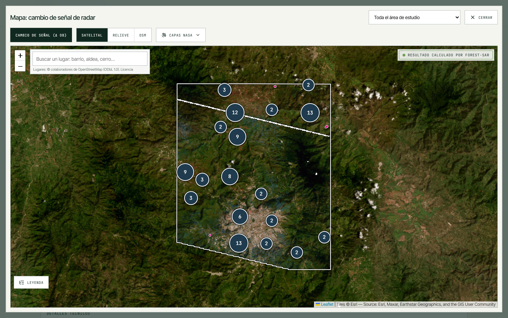
- **Cómo leer este mapa:** un panel de ayuda explica los símbolos.

:::aviso El contorno es una ayuda de lectura
El contorno de cada zona se dibuja uniendo las celdas candidatas con un margen de 50 m y simplificando 10 m para que sea legible. El área publicada es la **suma exacta de las celdas**, no el área del contorno.
:::

## 6.3 Mapas base

En la barra sobre el mapa se elige el mapa de fondo: **Satelital Esri** (por defecto), **Relieve OpenTopoMap** y **OpenStreetMap**. Desde el menú **Capas NASA** se pueden activar capas de **NASA GIBS** por fecha; si no hay imagen para esa fecha, el sitio muestra un aviso de "sin cobertura".

Las capas NASA solo se habilitan cuando se verificó que GIBS tiene imagen sobre la zona en las fechas del período. Hoy eso ocurre con el período de **12 días** (7 → 19 de octubre de 2026). En el período de **3 meses**, el 27 de julio no tiene cobertura verificada, así que esas capas aparecen deshabilitadas. Por eso la figura siguiente usa el período de 12 días: sus indicadores muestran 23 ha candidatas, no las 165 ha del período de 3 meses.

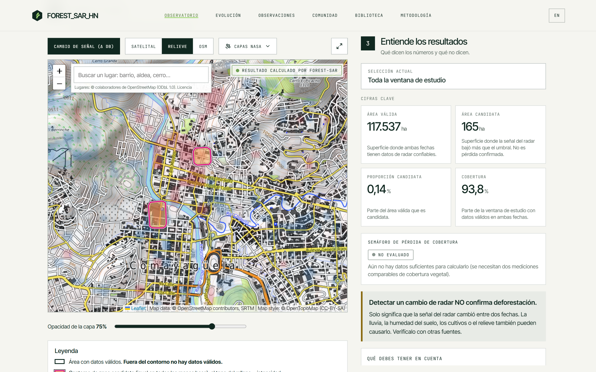

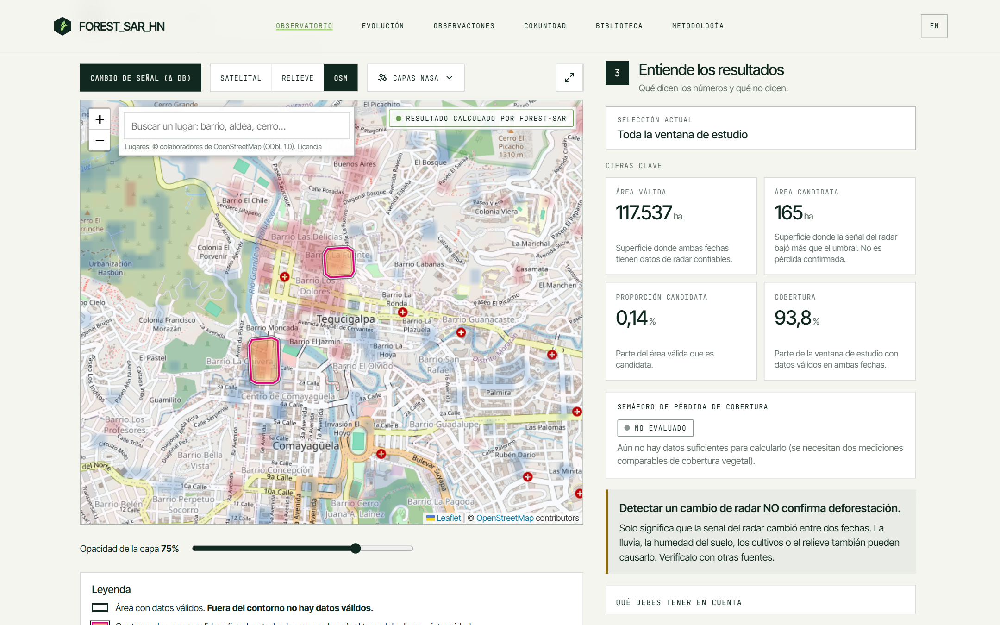

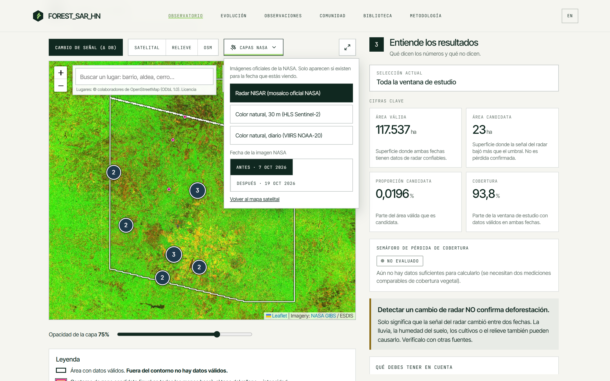

:::aviso La imagen de fondo no es de la fecha observada
La imagen satelital de referencia (Esri) y las capas ópticas sirven para ubicarse; **no corresponden a la fecha de la observación radar**. No use el fondo para concluir qué cambió.
:::

## 6.4 Agrupaciones y zonas

Para facilitar la lectura, las celdas candidatas cercanas se agrupan en **zonas**: se unen las celdas vecinas (incluidas las diagonales) y también las separadas por dos celdas vacías o menos (200 m o menos). De lejos, las zonas se agrupan además en burbujas numeradas.

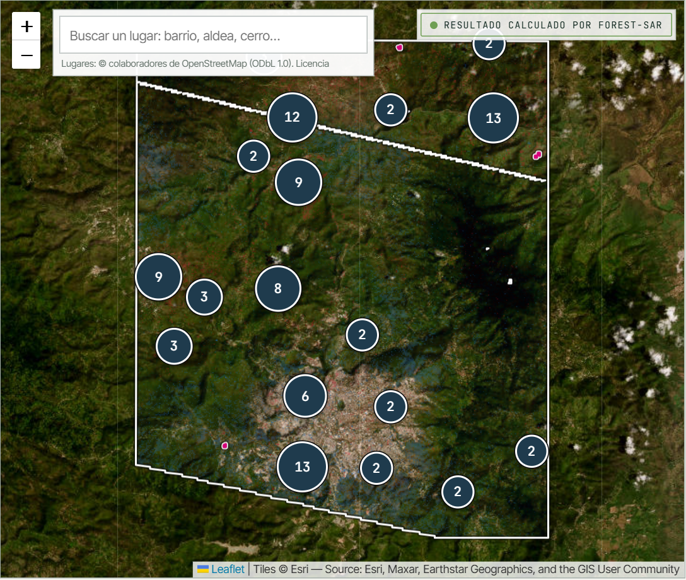

Al elegir una zona o una agrupación aparece una **tarjeta** con su área, el cambio medio, la localidad cercana y el botón **Ver evolución**, que abre la vista de Evolución.

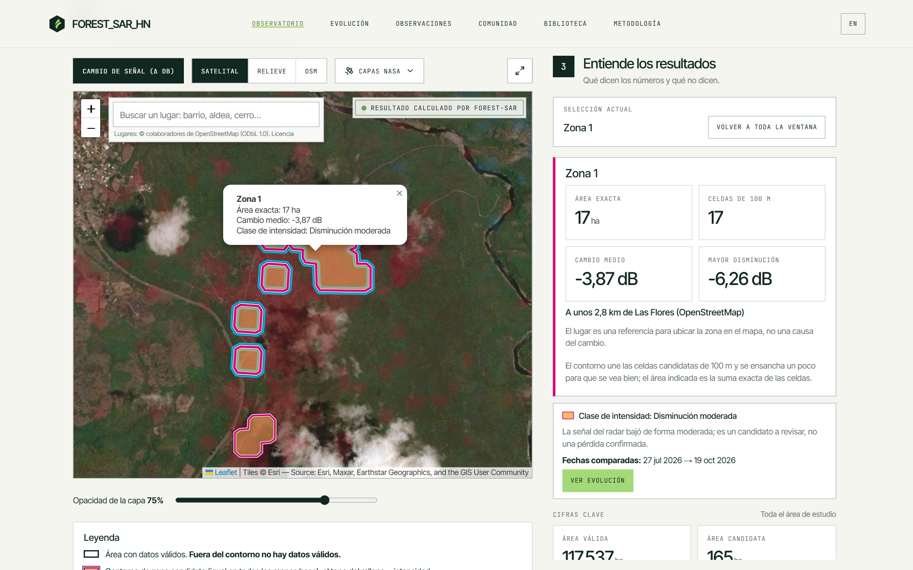

## 6.5 Búsqueda y localidades

El cuadro **Explora una zona** permite escribir el nombre de un lugar. La búsqueda es local: usa una lista de **536 lugares de OpenStreetMap** incluida en el sitio, así que no consulta servicios externos.

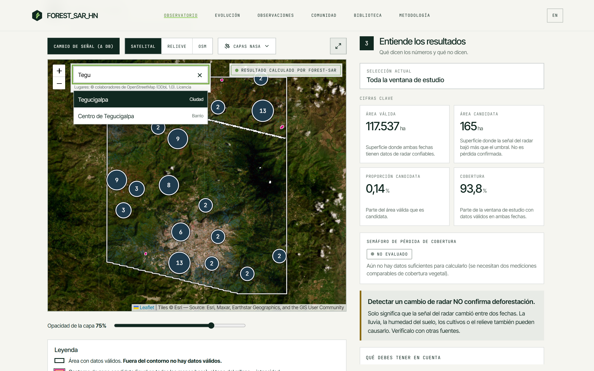

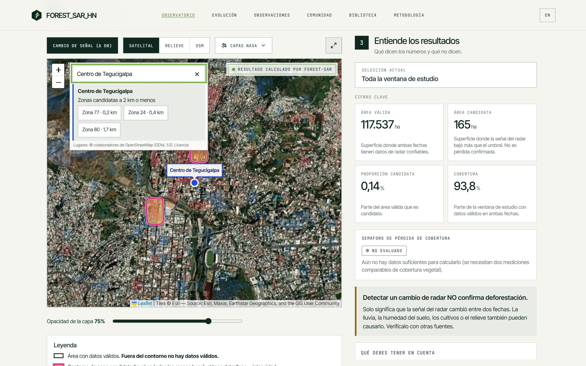

:::aviso Cercanía no es pertenencia administrativa
La localidad que se muestra para cada zona es la **más cercana** según OpenStreetMap. Estar cerca de un lugar no significa que la zona pertenezca a su municipio, aldea o propiedad, ni que ese lugar sea la causa.
:::

## 6.6 Indicadores

Los indicadores resumen el período elegido. Ejemplo real para 84 días:

| Indicador | Valor (84 días) | Cómo leerlo |
|---|---|---|
| Área candidata | 165 ha | Suma de celdas de 1 ha con caída de señal de 3 dB o más |
| Zonas candidatas | 98 | Grupos de celdas; no es el número de lugares afectados |
| Área válida | 117 537 ha | Superficie con datos válidos en ambas fechas |
| Proporción candidata | 0,14 % | Candidata dividida entre área válida |
| Cobertura | 93,8 % | Parte de la ventana con datos utilizables |

Para el mismo período, 85 zonas tienen una disminución media moderada (de −3 a −4,5 dB), 8 fuerte (−4,5 a −6 dB) y 5 muy fuerte (−6 dB o más).

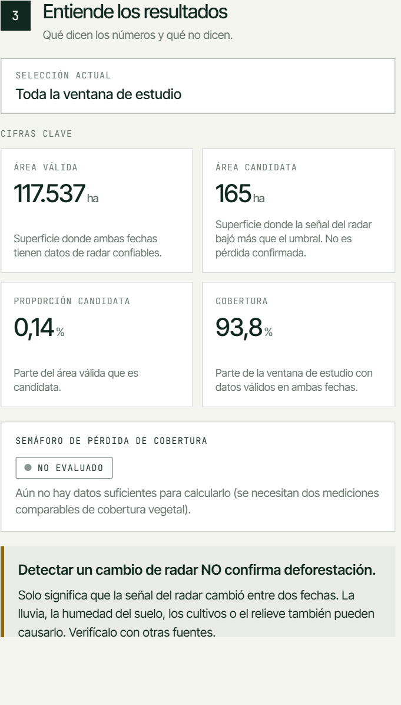

## 6.7 Intensidad y semáforo

La intensidad de cada zona se clasifica en cinco clases según el cambio medio en dB:

| Clase | Rango de cambio | Qué indica |
|---|---|---|
| Aumento | +3 dB o más | La señal aumentó; **no** significa recuperación |
| Estable | entre −3 y +3 dB | Dentro del umbral; no es candidata |
| Disminución moderada | −3 a −4,5 dB | Candidata de baja intensidad |
| Disminución fuerte | −4,5 a −6 dB | Candidata de intensidad media |
| Disminución muy fuerte | −6 dB o menos | Candidata de intensidad alta |
| Sin datos | sin valor | Se muestra gris con borde punteado; nunca como "estable" |

Solo el umbral de 3 dB está publicado como criterio de detección. Los cortes de −4,5 y −6 dB son **cortes de presentación** (la mitad y el total de la escala de ±6 dB del mapa), no niveles de daño.

Aparte, el **semáforo de cobertura vegetal** depende de una medida llamada TP. Como no hay mediciones comparables de cobertura vegetal, TP es nulo y el semáforo se muestra **"No evaluado"**. Esto es intencional: no se inventa un color.

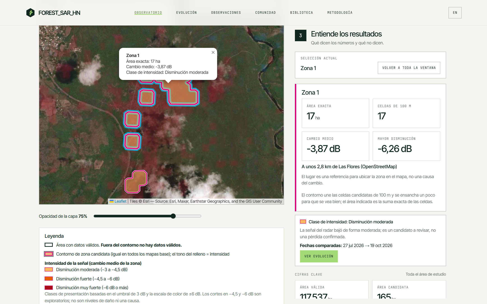

# 7. Analytics (Evolución)

La sección **Evolución** (`#/analytics`) reúne gráficos para entender el conjunto: resumen del período, línea de tiempo, intensidad por clase, lugares con más área candidata, escenas disponibles y la evolución de una zona concreta.

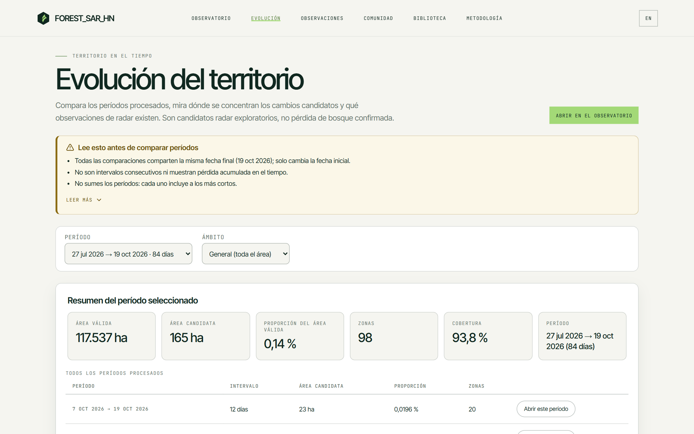

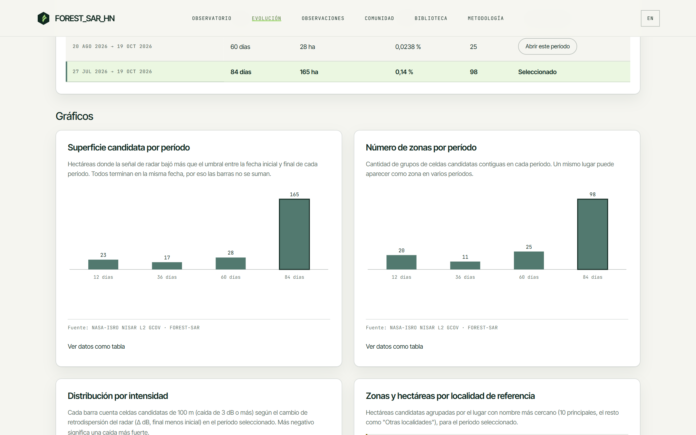

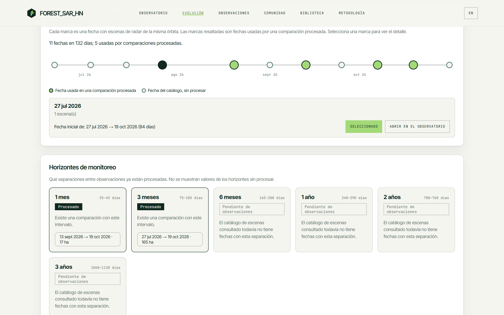

**Fecha final común.** Las cuatro comparaciones terminan el 2026-10-19; por eso la línea de tiempo muestra períodos que se solapan, no una serie de mediciones independientes.

:::aviso Comparación no es tendencia ni predicción
Una comparación entre dos fechas describe un cambio puntual. No es una tendencia (que necesita muchas observaciones independientes) ni una predicción. Los **horizontes de 6 meses a 3 años** aparecen en la pantalla como *pendientes*: aún no hay datos suficientes para mostrarlos.
:::

# 8. Observaciones

La sección **Observaciones** (`#/observations`) organiza los resultados por localidad cercana y permite descargar los datos en CSV.

1. Elija el período con los botones *12 días*, *1 mes*, *2 meses* o *3 meses*; las cifras superiores (observaciones, localidades, hectáreas y período) se actualizan.
2. Escriba una localidad en el buscador o elija una tarjeta de la lista, ordenada por área candidata. Se muestran 8 localidades y el botón **Mostrar más** despliega el resto.
3. Al abrir una localidad aparecen sus observaciones ("Observación 1 — 8 ha"…), con **Mostrar más** si son muchas.
4. La tarjeta de detalle muestra ubicación, fechas, área, intensidad y los botones **Ver en el mapa** y **Ver evolución**. Los identificadores, coordenadas y sectores de 1 km están en *Información científica*.

Los CSV tienen dos tipos de filas.

- **Zonas candidatas:** agrupaciones de celdas con su área y cambio medio.
- **Sectores de 1 km:** cuadrícula regular (EPSG:32616) usada para resumir los datos. Los sectores **no son zonas**: son cuadros fijos de análisis, mientras que las zonas siguen la forma de los candidatos.

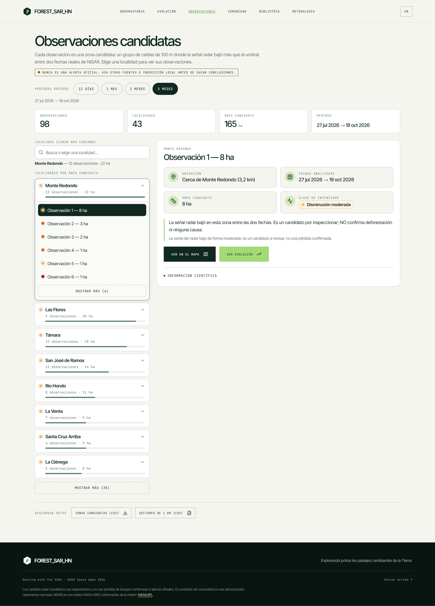

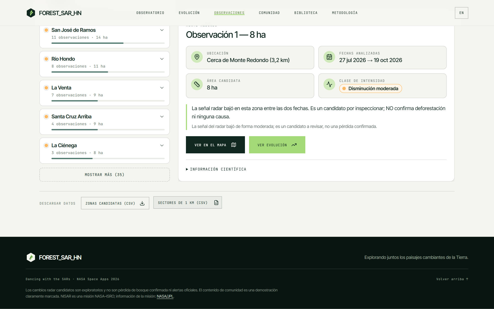

## 8.1 Columnas del CSV de zonas

`zone_id`, `localidad`, `distancia_km`, `area_ha`, `cell_count`, `mean_delta_db`, `min_delta_db`, `clase`, `centroid_lat`, `centroid_lon`, `initial_date`, `final_date` y `snapshot_id`. Muestra:

:::archivo capturas/14-csv-zonas-muestra.txt

## 8.2 Columnas del CSV de sectores

`observation_id`, `type`, `sector_id`, `region_id`, `pair_id`, `initial_date`, `final_date`, `source`, `candidate_area_ha`, `candidate_pct`, `valid_area_ha`, `coverage_pct`, `center_lat`, `center_lon`, `evidence_level` y `limitations`. Muestra:

:::archivo capturas/14-csv-sectores-muestra.txt

El nivel de evidencia actual es **1** (una sola pareja por comparación, sin confirmación externa). El campo `limitations` repite las limitaciones de cada fila.

# 9. Comunidad

La sección **Comunidad** es una **demostración local**: no hay cuentas, servidor ni moderación real. Ofrece ejemplos claramente marcados como demostración y herramientas para imaginar cómo sería una conversación comunitaria: publicaciones con filtros por categoría, comentarios y votos, encuestas, eventos, planes de preparación, tarjetas de aprendizaje y notas de campo.

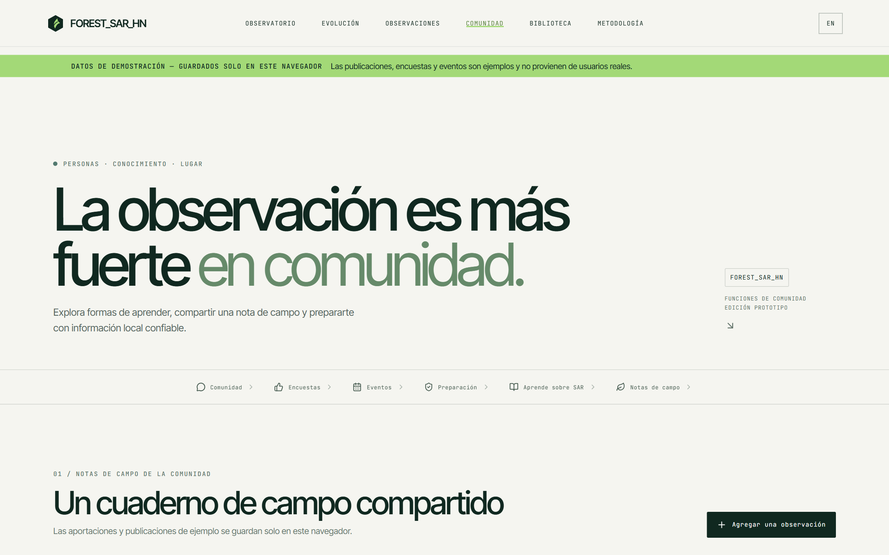

Lo que una persona escribe se guarda únicamente en su propio navegador (`localStorage`); no se envía a ningún sitio ni lo ven otras personas.

:::aviso Demostración
Las publicaciones, votos, encuestas y eventos de ejemplo **no son reales**. Esta sección muestra una idea de participación; no registra denuncias ni conecta con autoridades.
:::

# 10. Bosques y Conservación

La sección **Bosques y Conservación** (`#/conservation`, con un icono de pino en el menú) es una página educativa. Explica qué son los bosques de Honduras, qué áreas protegidas rodean al Distrito Central, qué los amenaza, por qué conviene conservarlos y cómo el radar satelital puede ayudar a notar cambios. Es independiente del Observatorio: **no procesa datos ni cambia los resultados científicos**, y casi todas sus cifras vienen de fuentes publicadas, no de FOREST_SAR_HN.

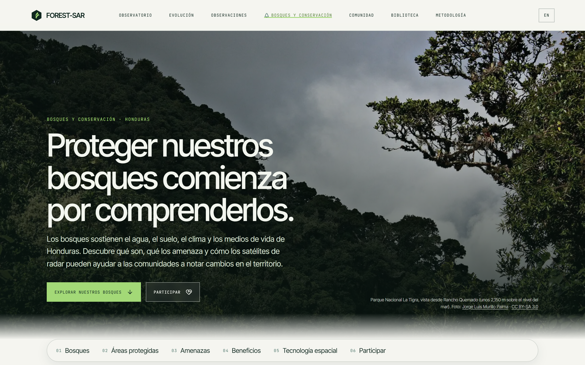

Debajo de la portada hay un **menú de seis apartados** (Bosques, Áreas protegidas, Amenazas, Beneficios, Tecnología espacial y Participar) que acompaña al bajar y marca dónde está la persona. Los botones llevan a cada apartado sin cambiar la dirección de la página. Se usa con teclado, y si el sistema pide reducir el movimiento, las animaciones se detienen.

:::nota Cómo leer las cifras de esta página
Cada cifra lleva su fuente entre paréntesis; al pulsarla se abre la lista de fuentes al final de la página. Las estadísticas nacionales se marcan **"Cifra histórica · 2018 · No es un resultado de FOREST-SAR"**. Las únicas cifras propias del sistema son las del bloque *Nuestro sistema, con datos reales* y se leen de los mismos archivos publicados que usa el Observatorio.
:::

## 10.1 Bosques de Honduras

Según el ICF (2018), Honduras tenía **5,384,424.88 ha de bosque**, cerca del **48 %** del territorio. El gráfico de barras muestra la distribución por tipo: latifoliado (57.1 %), conífero (36.6 %), mixto (5.3 %) y mangle (1.0 %). Al pasar el ratón o el foco sobre una barra se ve su superficie; al hacer clic queda fijada y se resalta la tarjeta del mismo tipo. El botón **Ver como tabla** muestra los mismos valores en una tabla.

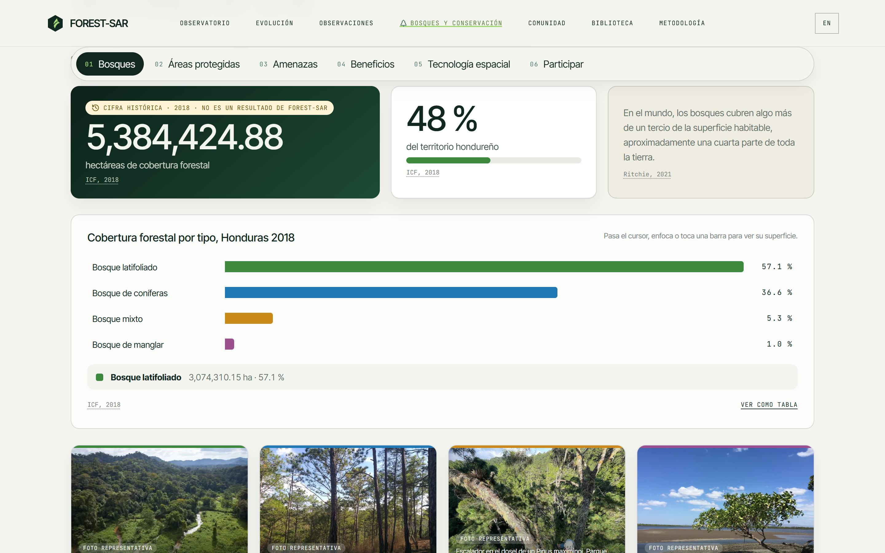

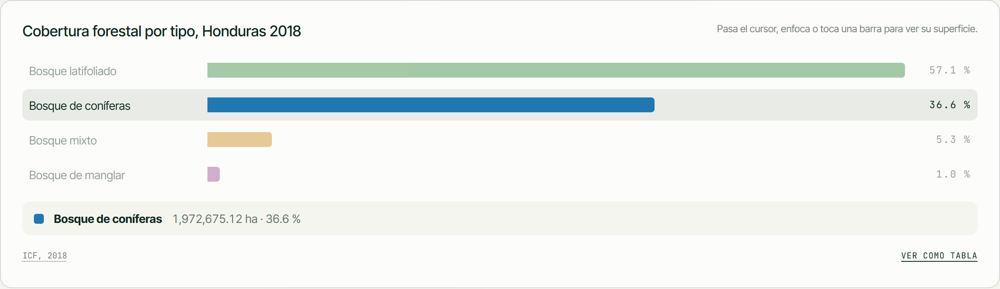

Cada tipo tiene una tarjeta con su porcentaje, su superficie y una **foto representativa** de Honduras: ilustra el tipo de bosque, no un sitio medido. Después se explica la diferencia entre *bosque*, *cobertura forestal* y *uso del suelo*, las tres clases de densidad del dosel (con dibujos ilustrativos) y algunas especies frecuentes.

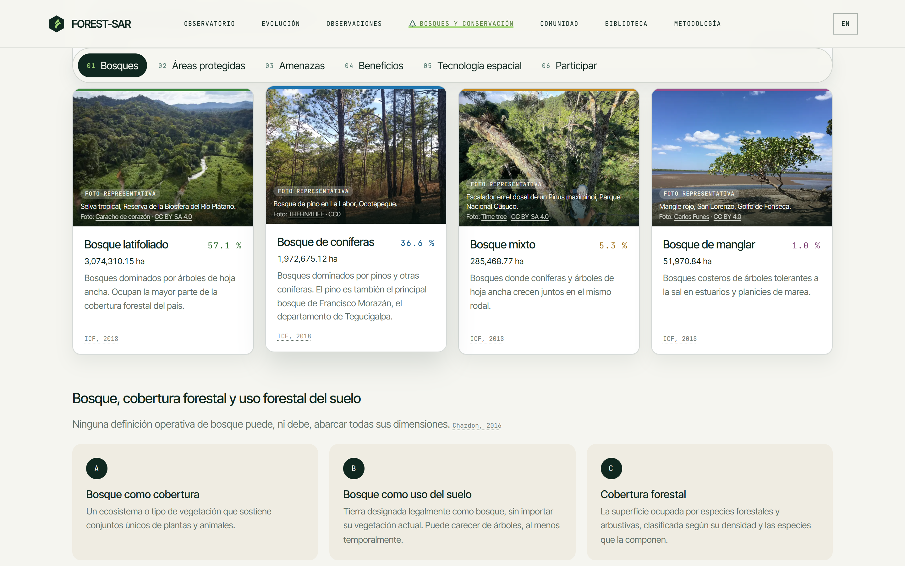

## 10.2 Áreas protegidas y región

Cuatro tarjetas presentan áreas protegidas del Distrito Central o de sus alrededores; el botón **Conocer más** abre una ventana con el detalle (se cierra con *Esc*).

| Área | Superficie reportada | Fuente |
|---|---|---|
| Parque Nacional La Tigra | 17,657 ha o ~24,000 ha (las fuentes difieren) | ICF, 2021; SINIT, 2024 |
| Refugio de Vida Silvestre Corralitos | 3,827.74 ha | ICF |
| Reserva Biológica Yerba Buena | 189.01 ha | ICF |
| Refugio de Vida Silvestre "Mero" | 5,107 ha, creado en 2024, en cuatro municipios | Brand Studio, 2024 |

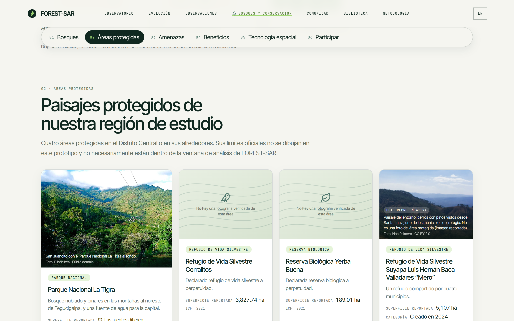

:::aviso Las fuentes de La Tigra no coinciden
Para La Tigra, el ICF (2021) reporta 17,657 ha y el SINIT (2024) unas 24,000 ha. Para el agua de Tegucigalpa, una fuente dice cerca del 30 % y el plan de manejo, con datos de 1997 del SANAA, el 40 %. La página muestra **ambas cifras, cada una con su fuente**, sin promediarlas, y aclara que no se pudo verificar el motivo de la diferencia.
:::

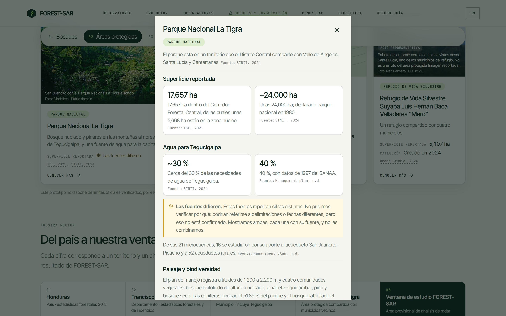

Corralitos y Yerba Buena no tienen una fotografía verificada, así que muestran el texto *"No hay una fotografía verificada de esta área"*. La tarjeta de "Mero" usa una foto del **paisaje del entorno** (cerros de Santa Lucía, uno de sus municipios) rotulada como tal: no es una foto del área protegida. **No se dibujan límites de áreas protegidas** en ningún mapa, porque el proyecto no dispone de límites oficiales verificados.

El bloque **Del país a nuestra ventana de estudio** separa cinco escalas que no deben mezclarse: Honduras, Francisco Morazán, el Distrito Central, La Tigra y la ventana de estudio de FOREST_SAR_HN. Para Francisco Morazán muestra 627,637 ha de bosque (73 % del departamento), 326,261 ha de pino, y 647 incendios y 61,820 ha quemadas en 2024 (ICF). La única cifra propia es el área válida de radar, **117,537 ha** por comparación.

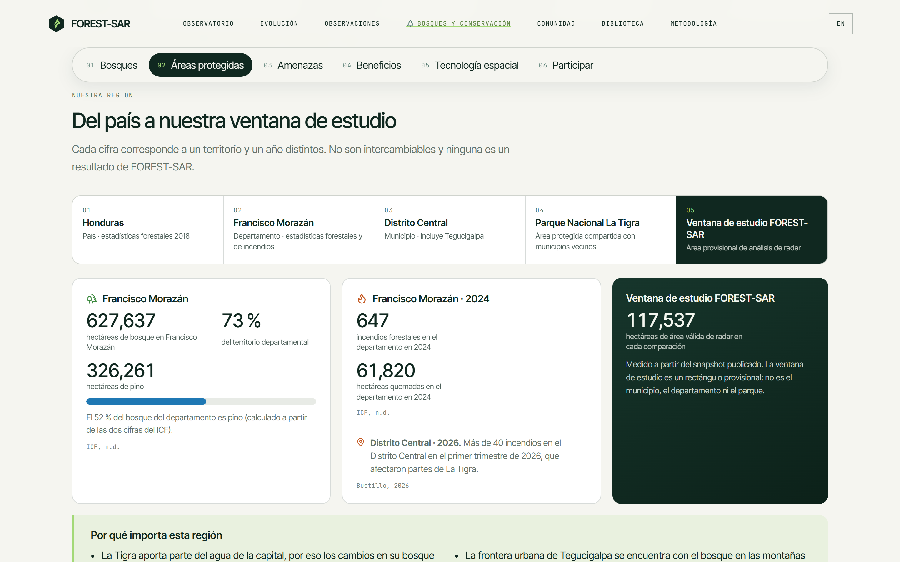

## 10.3 Amenazas, consecuencias y beneficios

Cuatro tarjetas describen las amenazas: **expansión agrícola y ganadera**, **expansión urbana**, **incendios forestales** y **fragmentación y degradación**. Cada una abre una ventana con más información y su fuente. Debajo hay cuatro consecuencias de la deforestación: pérdida de biodiversidad, emisiones de gases de efecto invernadero, alteración de los ciclos del agua y del clima, y mayor riesgo de desastres.

:::aviso El radar no identifica causas
Un aviso visible recuerda que **FOREST-SAR detecta cambios en la señal de radar, no su causa**. Ninguna amenaza de esta página se atribuye a una zona candidata del Observatorio.
:::

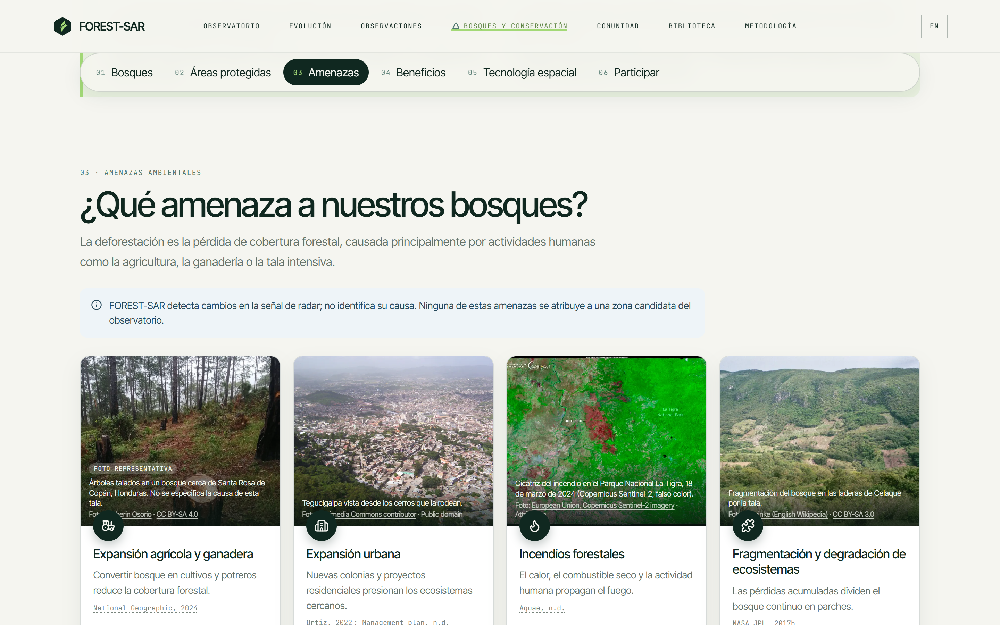

El apartado **Bosques saludables. Comunidades más fuertes.** resume siete beneficios de conservar (carbono, agua, biodiversidad, suelo, regulación ambiental, recursos para las comunidades y resiliencia) y explica por qué conviene monitorear de forma continua.

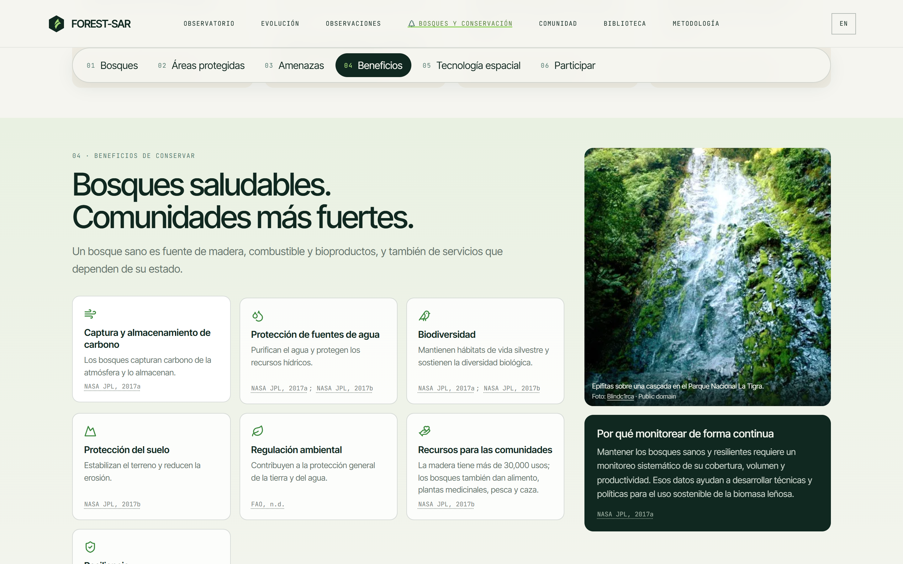

## 10.4 Tecnología espacial

Este apartado explica la percepción remota (sensores pasivos y activos), el radar SAR y la misión NISAR con sus bandas L y S. Incluye una **animación ilustrativa** de seis pasos que se puede pausar; está rotulada como ilustración y no muestra datos reales.

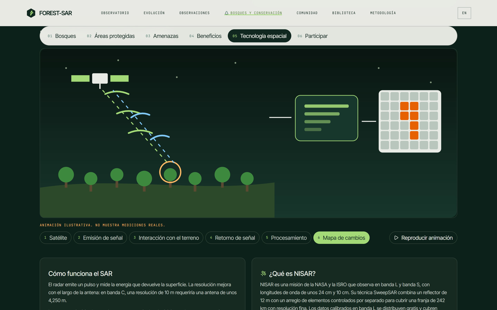

Las capacidades previstas de la misión NISAR se presentan **separadas** de lo que FOREST_SAR_HN hace hoy. El bloque **Nuestro sistema, con datos reales** muestra cifras leídas del snapshot publicado: 52 escenas catalogadas, 162 pares compatibles, 4 comparaciones y el área candidata de cada una (23, 17, 28 y 165 ha), con la nota de que **no se suman**. Desde aquí se va al Observatorio o a la Metodología.

Las tarjetas de **Investigaciones y aplicaciones del radar** (JERS-1, ALOS, ALOS-2, UAVSAR y radar aerotransportado) llevan la etiqueta **"Misión anterior"**: son ejemplos descritos por la NASA, no resultados de NISAR ni de FOREST_SAR_HN.

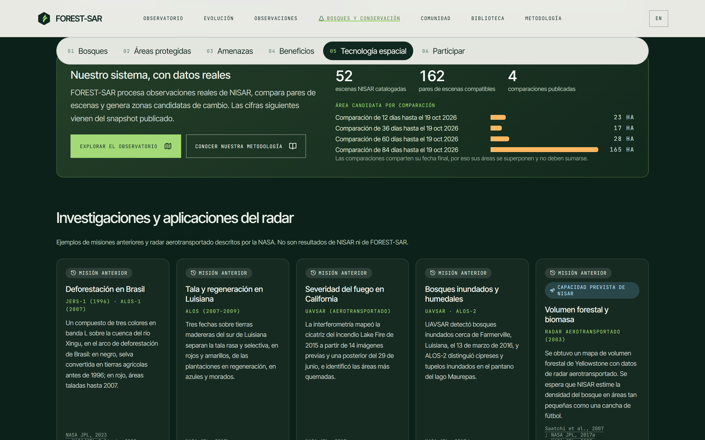

## 10.5 Participar

La persona puede elegir **uno o varios roles**: observador de campo, analista de imágenes, enlace comunitario, brigadista forestal, comunicaciones y voluntariado. El rol de brigadista recuerda que la respuesta a incendios requiere capacitación, coordinación y equipo de seguridad.

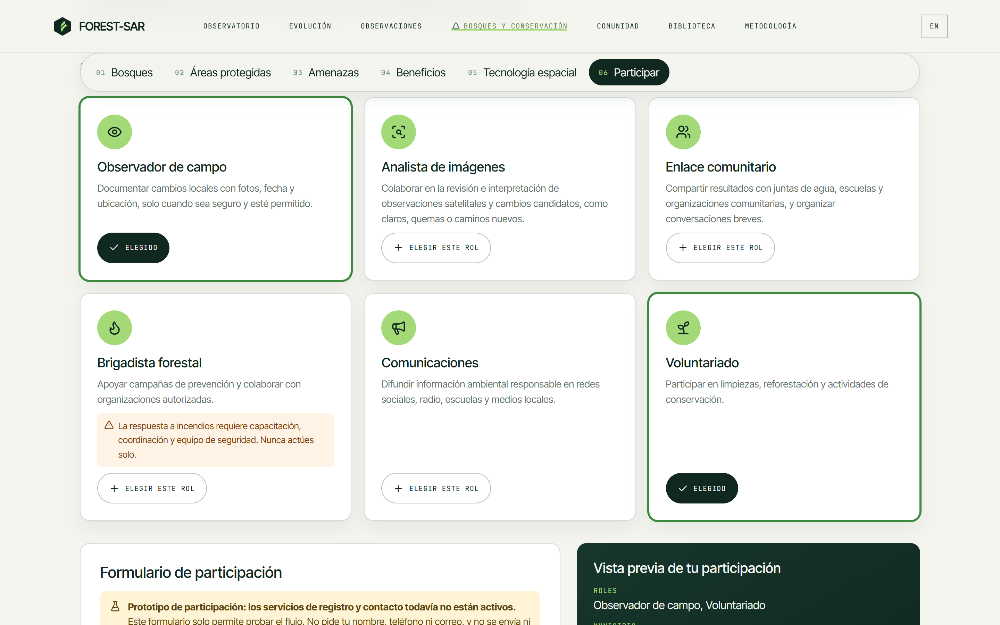

El **formulario** muestra los roles elegidos, permite elegir el municipio y el medio de contacto preferido (sin escribir ningún dato) y genera una **vista previa** de la participación. Desde allí se puede pasar a la sección Comunidad.

:::aviso Prototipo de participación
Los servicios de registro y contacto todavía no están activos. El formulario **no pide nombre, teléfono ni correo**, no envía nada por Internet y no guarda nada en el navegador: la vista previa solo existe mientras la página está abierta y dice expresamente que no se envió ni se guardó nada.
:::

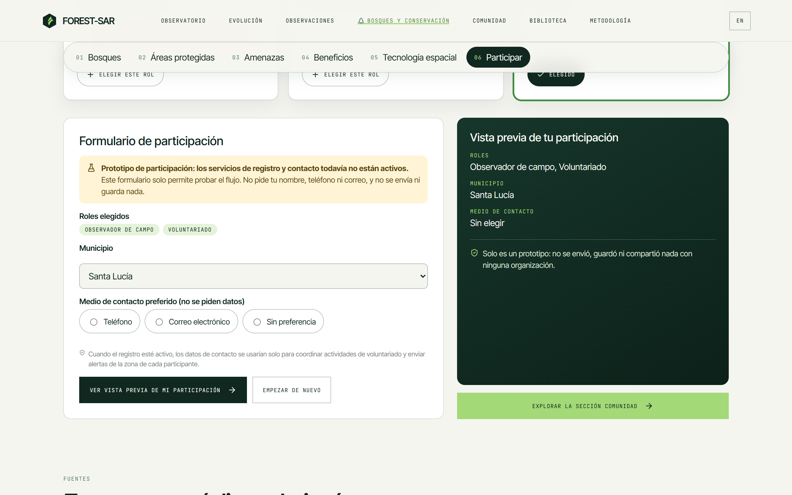

## 10.6 Fuentes, fotografías y uso en el teléfono

Al final de la página, **Fuentes** reúne las citas del documento del equipo. Solo tienen enlace las páginas oficiales que se abrieron y comprobaron; las demás aparecen como *"Sin enlace verificado"*. **Créditos de imágenes** lista las 12 fotografías de Wikimedia Commons con autor y licencia (CC BY-SA, CC BY, CC0 o dominio público). Ninguna imagen fue generada por IA.

La página se adapta al teléfono: los apartados pasan a una columna y el menú de apartados se desliza horizontalmente.

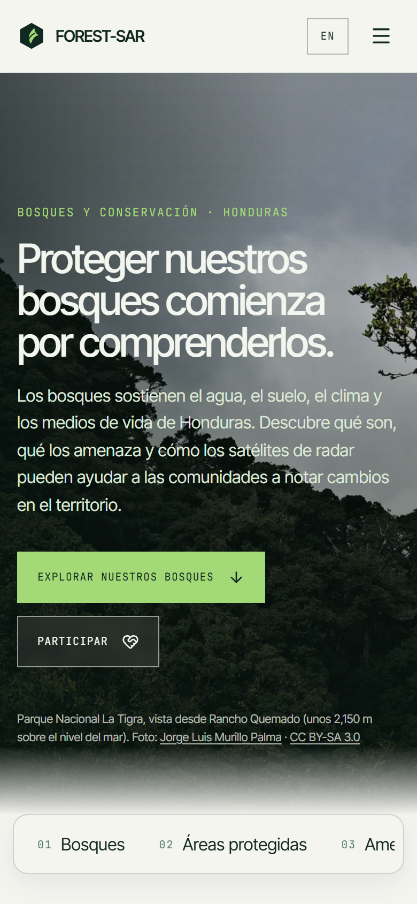

# 11. Biblioteca

La **Biblioteca** reúne enlaces oficiales para profundizar: documentación del producto NISAR GCOV (ASF), herramientas de datos de OPERA, el buscador de ASF, la documentación de GIBS y NASA Worldview. Se presentan como una galería de tarjetas con una ilustración propia por tipo de recurso (guía, catálogo, capas, API, visor de mapas), su dominio y el botón **Abrir recurso**. Son recursos externos; el sitio no los copia ni muestra capturas de ellos.

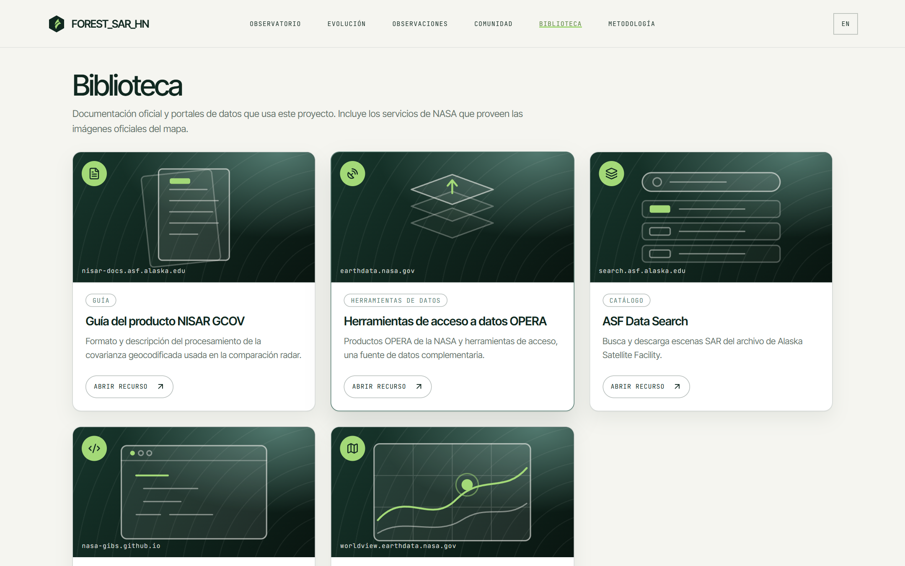

# 12. Metodología

La página **Metodología** del sitio explica el procesamiento. Aquí se resume, primero con palabras sencillas y luego con las fórmulas implementadas.

En esa misma página, la tarjeta **Manual de usuario** abre este documento dentro de una ventana: con **Ver manual** se lee sin salir del sitio, y con **Descargar PDF** se guarda una copia. Si el navegador del teléfono no muestra PDF dentro de la página, la ventana ofrece descargarlo o abrirlo en otra pestaña.

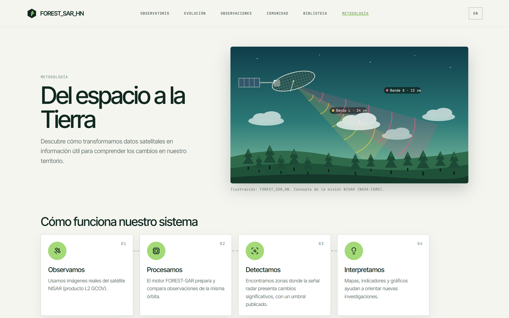

## 12.1 Explicación sencilla

1. Se buscan escenas NISAR públicas y se forman **parejas** de la misma órbita.
2. Se descarga solo la zona de estudio, el canal HVHV y la máscara de calidad.
3. Se promedia la señal en **cuadros de 100 m** para reducir el ruido propio del radar.
4. Se compara la señal final con la inicial, cuadro por cuadro, en **decibelios (dB)**.
5. Si la señal bajó **3 dB o más**, el cuadro es *candidato*.
6. Los candidatos cercanos se unen en **zonas** y se publican con sus cifras.

## 12.2 Fórmulas y reglas implementadas

| Paso | Regla implementada |
|---|---|
| Producto | NISAR L2 GCOV, gamma0, canal HVHV (potencia lineal), banda L, 10 m |
| Píxel válido | Máscara GCOV con valor entre 1 y 254; se excluyen NaN, relleno y valores no positivos |
| Multilook | Bloques de 10×10 píxeles de 10 m = celdas de 100 m (1 ha); promedio en potencia lineal de los píxeles válidos en **ambas** fechas |
| Celda válida | Fracción válida de al menos 0,9 |
| Cambio | Δ dB = 10 · log10(P_final / P_inicial) por celda |
| Candidata | Δ dB ≤ −3 dB (umbral exploratorio) |
| Área candidata | Número de celdas candidatas × 1 ha |
| Sectores | Cuadrícula de 1 km en EPSG:32616, distinta de las zonas |
| Zonas | Componentes conectados (8 vecinos) de celdas candidatas, fusionados si están separados por 2 celdas vacías o menos (200 m) |
| Contorno | Unión de celdas con margen de 50 m, simplificada a 10 m; el área es la suma exacta de celdas |

:::nota Por qué en potencia lineal
Se promedia primero en potencia lineal y luego se convierte a dB, porque promediar valores ya expresados en dB distorsiona el resultado. Una caída de 3 dB equivale aproximadamente a la mitad de la potencia.
:::

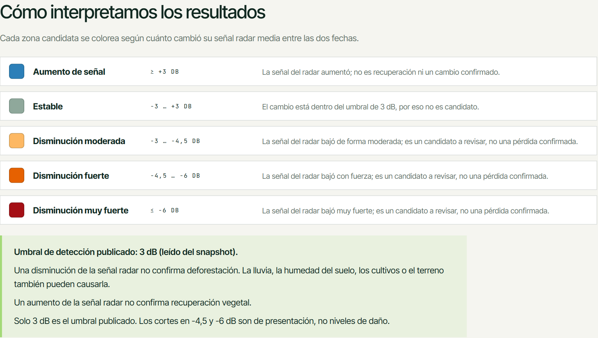

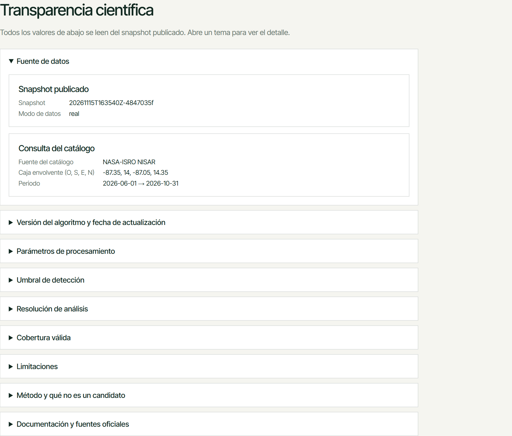

## 12.3 Qué puede cambiar la señal además de la vegetación

La humedad del suelo y de la vegetación, la lluvia, la estación, el relieve y la geometría de observación también modifican la retrodispersión. El período de 84 días cruza la estación lluviosa. Por eso un candidato no puede interpretarse como pérdida de bosque sin otra evidencia.

## 12.4 Datos técnicos

La página **Datos técnicos** (`#/data`) lista las comparaciones, las escenas y las parejas (compatibles e incompatibles, con el motivo), junto con identificadores reales de cada escena.

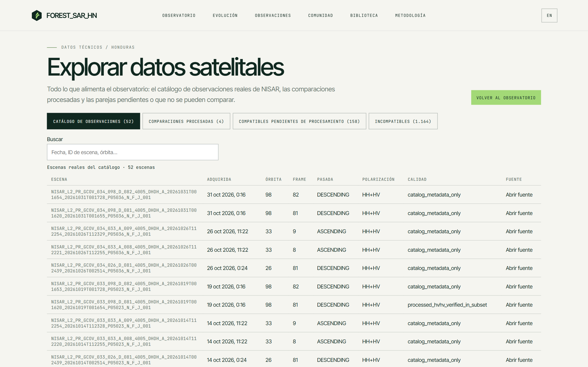

# 13. Arquitectura

FOREST_SAR_HN separa lo que necesita red y credenciales (el motor) de lo que ve el público (un sitio estático).

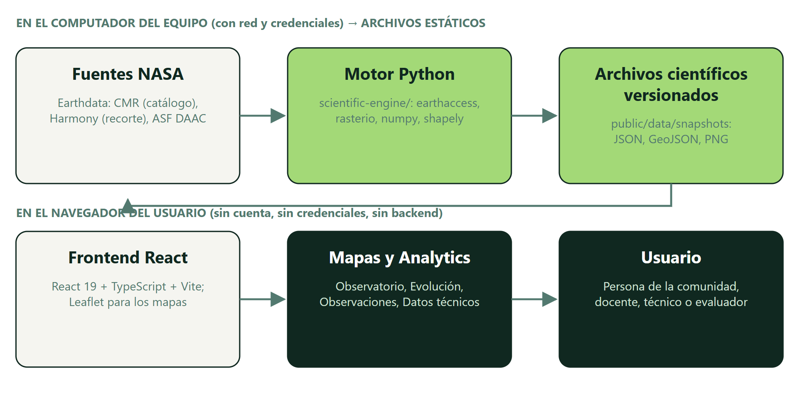

## 13.1 Por qué el sitio no necesita credenciales

Solo el motor científico se conecta a NASA Earthdata y lo hace desde el computador del equipo, usando un token guardado en el entorno y nunca en el repositorio. El resultado son archivos JSON, GeoJSON y PNG dentro de `public/data/snapshots`. El navegador solo **lee** esos archivos: no hay servidor propio, base de datos ni inicio de sesión. La comprobación `build:publish` se detiene si encuentra claves, rutas locales o archivos privados en la versión que se subirá.

## 13.2 Cómo se agregan nuevas observaciones

Hoy es un proceso manual y supervisado:

1. Se ejecuta el motor para consultar el catálogo y elegir una pareja compatible.
2. El motor descarga el recorte, procesa y escribe una nueva carpeta versionada en `public/data/snapshots`.
3. Se actualiza el índice de comparaciones y se revisan los resultados.
4. Se ejecutan las pruebas, se genera la versión de publicación y se sube el sitio estático.

Cada resultado conserva el identificador de las escenas, la versión del algoritmo y un registro de procesamiento. No hay actualización automática.

## 13.3 Cómo se organizó el trabajo con agentes de IA

El desarrollo se organizó por lotes con un coordinador y agentes especializados. Los agentes ayudaron a escribir, revisar y probar; no tomaron decisiones por su cuenta ni publicaron nada. Cada lote se registra en `PROGRESS.md` y `HANDOFF.md`, y una persona del equipo revisa las afirmaciones científicas antes de publicarlas.

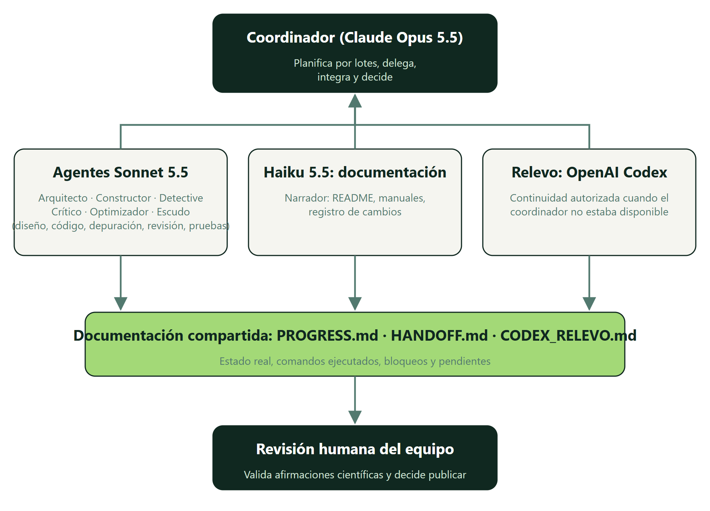

# 14. Limitaciones y uso responsable

:::aviso Lo que este sitio no es
- No es deforestación confirmada: es una **disminución candidata de retrodispersión**.
- No es una alerta oficial ni un servicio de emergencias.
- No identifica causas ni responsables, y no acusa a nadie de tala ilegal.
- No es una predicción ni una tendencia.
:::

- **Producto provisional.** Casi todas las escenas usan la colección `NISAR_L2_GCOV_PROVISIONAL_V1`; sus valores pueden cambiar en versiones posteriores.
- **Ventana provisional.** El rectángulo de estudio no es un límite municipal.
- **Una sola pareja por comparación.** Nivel de evidencia 1; no hay repetición independiente ni validación en campo.
- **Cobertura parcial.** El 93,8 % del área es válida; el resto no se evalúa.
- **Aviso conocido de ASF** (2026-02-27): la máscara GCOV puede desalinearse en los bordes del producto.
- **Semáforo no evaluado.** No hay mediciones comparables de cobertura vegetal.
- **Mapas de fondo.** No corresponden a la fecha de observación del radar.
- **Comunidad.** Es demostración local.
- **Bosques y Conservación.** Sus estadísticas son históricas y de otras fuentes (ICF 2018 y otras), no resultados de FOREST_SAR_HN. Varias citas no tienen enlace verificado, dos áreas protegidas no tienen foto verificada y no se dibujan límites oficiales. El formulario de participación es solo un prototipo.

**Uso responsable.** Use los candidatos como **invitación a mirar con otras fuentes**: imágenes ópticas, información local y visitas de campo. Cite siempre las fechas y el nivel de evidencia, y evite señalar propiedades o personas.

# 15. Preguntas frecuentes

**1. ¿Esto muestra deforestación?** No. Muestra zonas donde la señal del radar bajó al menos 3 dB. Puede deberse a pérdida de vegetación, pero también a humedad, lluvia, estación o cambios del terreno.

**2. ¿Por qué 165 ha y no una cifra mayor o menor?** Es el número de celdas de 1 ha cuya señal bajó 3 dB o más entre 2026-07-27 y 2026-10-19. Si cambia el umbral o el período, cambia la cifra.

**3. ¿Puedo sumar los períodos?** No. Todos terminan el 2026-10-19, se solapan y una zona puede estar en varios.

**4. ¿Por qué el semáforo dice "No evaluado"?** Porque necesita una medida de cobertura vegetal comparable (TP) que no existe todavía. Preferimos no mostrar un color inventado.

**5. ¿La imagen de fondo muestra lo que ocurrió?** No. El mapa de fondo no es de la fecha observada; solo sirve de referencia.

**6. ¿La localidad indicada es donde ocurrió el cambio?** Es la localidad de OpenStreetMap más cercana. La cercanía no equivale a pertenencia administrativa.

**7. ¿Los datos se actualizan solos?** No. Se procesan y se publican manualmente; no hay monitoreo automático.

**8. ¿Necesito una cuenta o una clave de NASA para usar el sitio?** No. Solo el equipo la necesita para procesar datos nuevos.

**9. ¿Las publicaciones de Comunidad son reales?** No. Son una demostración local y quedan solo en su navegador.

**10. ¿Las cifras de Bosques y Conservación las calculó FOREST_SAR_HN?** No. Las estadísticas de bosques, áreas protegidas e incendios vienen del ICF y de otras fuentes citadas, y se marcan con su año. Las únicas cifras propias de esa página (escenas, pares, comparaciones y hectáreas candidatas) se leen de los archivos publicados del Observatorio.

**11. ¿El formulario de Participar me registra?** No. Es un prototipo: no pide nombre, teléfono ni correo, y no envía ni guarda nada.

**12. ¿Se usó inteligencia artificial?** Sí, para apoyar el desarrollo y la documentación (Claude Code y Codex) con revisión humana. No hay IA en el sitio ni imágenes generadas por IA.

# 16. Futuras mejoras

Lo siguiente **no existe todavía**; es una lista de posibilidades que dependen de tiempo, datos y validación.

- Incorporar más observaciones NISAR para series más largas y horizontes de 6 meses a 3 años.
- Comparar parejas independientes (sin fecha final común) para estimar el ruido natural.
- Validación en campo y con imágenes ópticas, con ayuda de las comunidades.
- Una medida real de cobertura vegetal (TP) para activar el semáforo.
- Actualización programada de los datos con registro de errores.
- Una comunidad real con moderación, si el equipo y los aliados lo deciden.
- Límites administrativos oficiales para reemplazar la ventana provisional.
- Evaluación de accesibilidad con usuarios y más idiomas.

# 17. Referencias, declaración de IA y equipo

## 17.1 Referencias

| Recurso | Enlace |
|---|---|
| NISAR (NASA/JPL) | [nisar.jpl.nasa.gov](https://nisar.jpl.nasa.gov/) |
| NASA Earthdata | [earthdata.nasa.gov](https://www.earthdata.nasa.gov/) |
| ¿Qué es SAR? (Earthdata) | [what-is-sar](https://www.earthdata.nasa.gov/learn/backgrounders/what-is-sar) |
| ASF DAAC | [asf.alaska.edu](https://asf.alaska.edu/) |
| Documentación del producto GCOV | [nisar-docs.asf.alaska.edu/gcov](https://nisar-docs.asf.alaska.edu/gcov/) |
| Buscador de datos de ASF | [search.asf.alaska.edu](https://search.asf.alaska.edu/) |
| NASA Harmony | [harmony.earthdata.nasa.gov](https://harmony.earthdata.nasa.gov/) |
| CMR (catálogo) | [cmr.earthdata.nasa.gov](https://cmr.earthdata.nasa.gov/search/site/docs/search/api.html) |
| NASA Worldview | [worldview.earthdata.nasa.gov](https://worldview.earthdata.nasa.gov/) |
| GIBS (documentación) | [nasa-gibs.github.io/gibs-api-docs](https://nasa-gibs.github.io/gibs-api-docs/) |
| OPERA (herramientas de acceso) | [earthdata.nasa.gov/data/projects/opera](https://www.earthdata.nasa.gov/data/projects/opera/data-access-tools) |
| ICF (Instituto de Conservación Forestal) | [icf.gob.hn](https://www.icf.gob.hn/) |
| NASA, misión NISAR | [science.nasa.gov/mission/nisar](https://science.nasa.gov/mission/nisar/) |
| Percepción remota (Earthdata) | [remote-sensing](https://www.earthdata.nasa.gov/learn/earth-observation-data-basics/remote-sensing) |
| Deforestación (Our World in Data) | [ourworldindata.org/deforestation](https://ourworldindata.org/deforestation) |
| Deforestación (National Geographic Education) | [education.nationalgeographic.org](https://education.nationalgeographic.org/resource/deforestation/) |
| Chazdon et al. (2016), definición de bosque | [doi.org/10.1007/s13280-016-0772-y](https://doi.org/10.1007/s13280-016-0772-y) |
| Wikimedia Commons (fotografías) | [commons.wikimedia.org](https://commons.wikimedia.org/) |
| OpenStreetMap (licencia ODbL) | [openstreetmap.org/copyright](https://www.openstreetmap.org/copyright) |
| ISRO | [isro.gov.in](https://www.isro.gov.in/) |
| React | [react.dev](https://react.dev/) |
| Vite | [vite.dev](https://vite.dev/) |
| Leaflet | [leafletjs.com](https://leafletjs.com/) |
| Guía de entrega de Space Apps | [spaceappschallenge.org](https://www.spaceappschallenge.org/resources/project-submission-guide/) |

Las menciones a NASA, ISRO y otras instituciones indican la fuente de los datos y no implican su respaldo al proyecto. No se modificó ningún logotipo de NASA ni de ISRO.

## 17.2 Declaración de uso de inteligencia artificial

- **Desarrollo:** el código, la documentación y el procesamiento se orquestaron con **Claude Code** (Anthropic): Claude Opus 5.5 como coordinador, Claude Sonnet 5.5 como agentes de implementación y revisión, y Claude Haiku 5.5 para documentación. **OpenAI Codex** actuó como agente de relevo, según consta en `PROGRESS.md`, `HANDOFF.md` y `CODEX_RELEVO.md`.
- **En tiempo de ejecución:** el sitio y el motor **no usan IA generativa** y no requieren claves de servicios de IA.
- **Imágenes:** ninguna imagen del proyecto fue generada por IA. Las ilustraciones son SVG/CSS originales, las fotografías de *Bosques y Conservación* son de Wikimedia Commons con autor y licencia, y las capturas de este manual son de la propia aplicación.
- **Responsabilidad humana:** el equipo revisa las afirmaciones científicas. El resultado de una IA no es un resultado científico validado.

## 17.3 Contribuciones del equipo

:::nota Espacio editable
Complete esta sección con los nombres y los roles de las personas del equipo.

- [Nombre y apellido] — [rol y contribución]
- [Nombre y apellido] — [rol y contribución]
- [Nombre y apellido] — [rol y contribución]
:::
